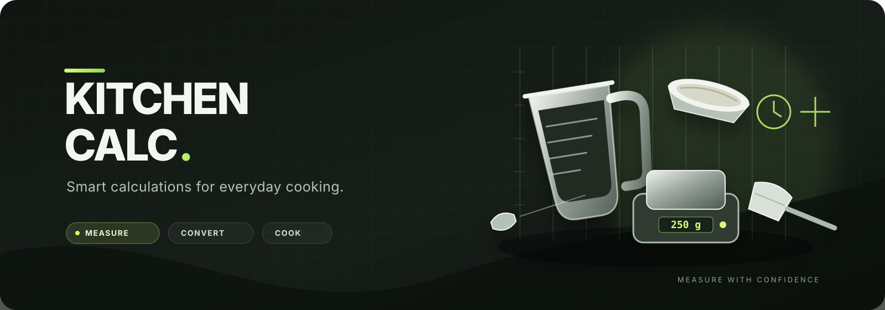

# Kitchen Calc

<p align="center">
  
</p>

A focused, browser-based kitchen companion for recipe scaling, ingredient organization, shopping preparation, cooking timers, and measurement conversion.

<p align="center">
  <strong>One standalone app. Everyday kitchen workflows. No build step required.</strong>
</p>

<p align="center">
  <a href="./kitchen_calc.html">Open Kitchen Calc</a> ·
  <a href="./docs/PROJECT_OVERVIEW.md">Project overview</a> ·
  <a href="./CONTRIBUTING.md">Contributing</a>
</p>

---

## At a glance

| Workspace | Purpose |
| --- | --- |
| Recipe Scaler | Adjust ingredient quantities for a target serving count. |
| Recipe Library | Browse and filter recipe ideas using the available controls. |
| Pantry | Keep track of ingredients and expiry information. |
| Shopping List | Collect and manage items needed for shopping. |
| Cooking | Follow cooking steps and use timers while preparing a dish. |
| Converter | Convert kitchen quantities and ingredient measurements. |

The app also includes appearance preferences and browser-based capabilities where implemented in the supplied source.

## Get started

Kitchen Calc is packaged as a standalone HTML application.

1. Clone this repository:
   ```bash
   git clone https://github.com/yoyo-0909/kitchen-calc.git
   cd kitchen-calc
   ```
2. Open `kitchen_calc.html` in a modern browser.

Alternatively, run a local static server:

```bash
python -m http.server 8000
```

Then open [http://localhost:8000/kitchen_calc.html](http://localhost:8000/kitchen_calc.html).

Some resources are loaded from external CDNs, so an internet connection may be required for the complete experience.

## Repository layout

```text
kitchen-calc/
├── kitchen_calc.html
├── README.md
├── CONTRIBUTING.md
├── .gitignore
└── docs/
    └── PROJECT_OVERVIEW.md
```

## Built with

- HTML5
- JavaScript
- Tailwind CSS via CDN
- Browser APIs where used by the application

There is currently no required package installation, bundler, or build pipeline.

## Design constraint: UI is locked

**The existing Kitchen Calc interface must not be redesigned or visually changed.**

Preserve its current colors, typography, layout, spacing, navigation, component arrangement, and responsive presentation. Repository-level improvements—documentation, organization, issue templates, and development guidance—are welcome. Functional fixes are welcome when they do not alter the UI.

See [CONTRIBUTING.md](./CONTRIBUTING.md) for the project rules.

## Project status

This repository contains the supplied standalone prototype and its supporting documentation. The README intentionally describes the project at a high level; verify individual behaviors in the application source before relying on them.

## Contributing

Before proposing changes, read [CONTRIBUTING.md](./CONTRIBUTING.md). Keep changes focused, test the affected workflow, and document meaningful behavior changes.

---

<p align="center">
  <strong>Kitchen Calc</strong><br />
  Plan clearly. Measure confidently. Cook happily.
</p>
